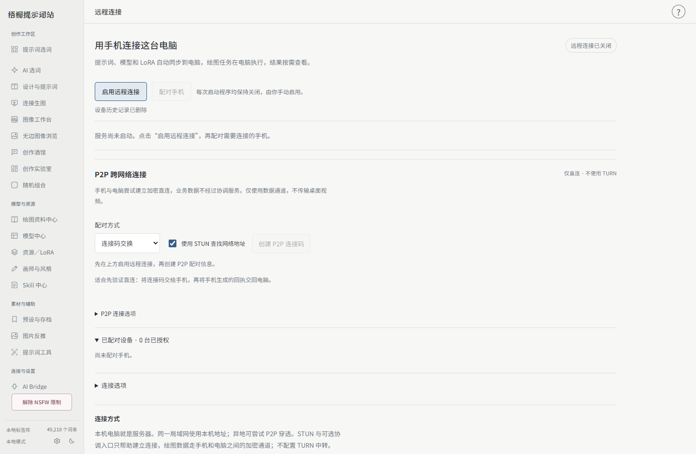
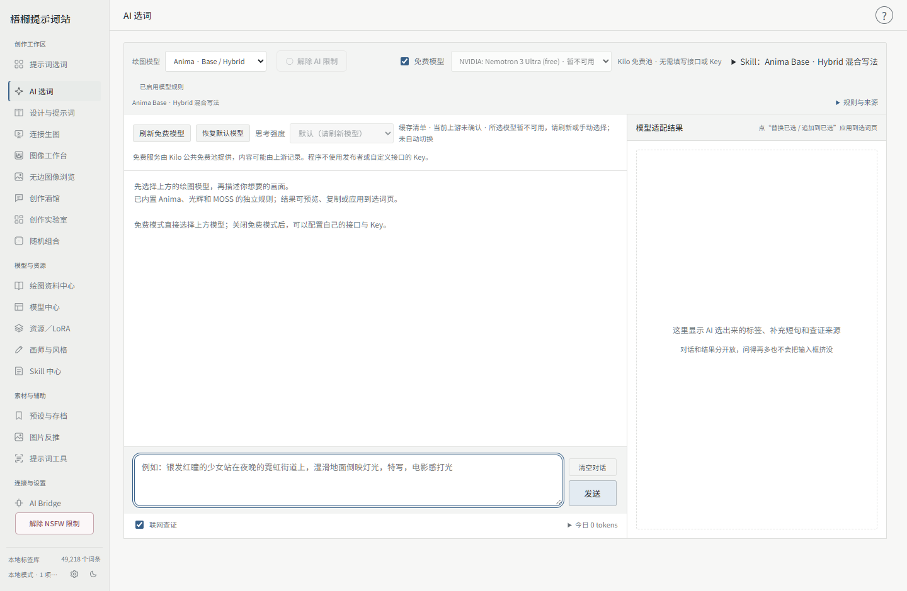
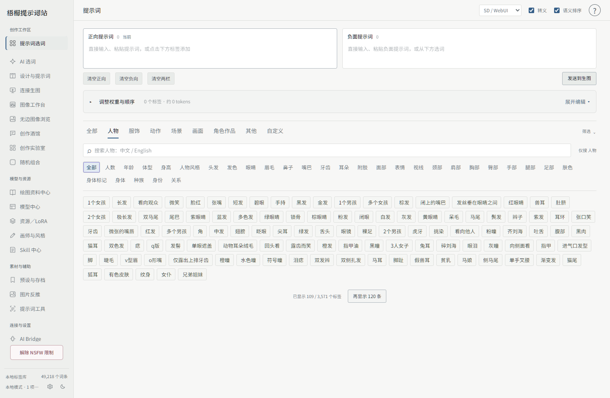
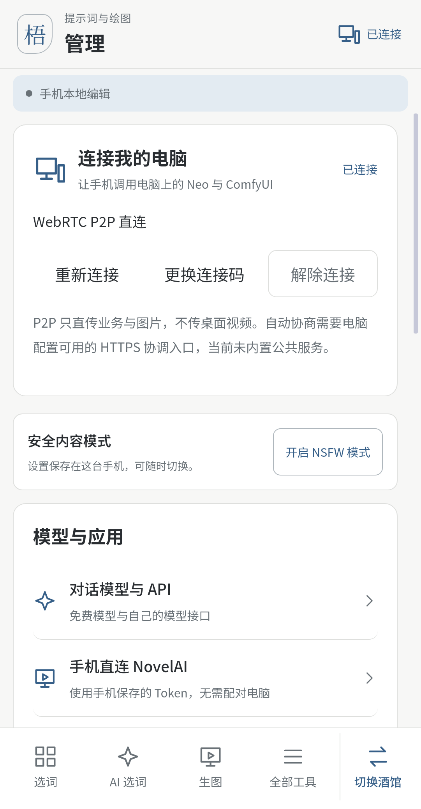

# 梧桐提示词站

**Windows 创作工作台 · Android 手机版 · 提示词与绘图协作**

用中文描述画面，让内置 AI 按绘图模型生成提示词；也可以手动选词、整理角色和画师串、管理模型与 LoRA，再连接绘图引擎生成图片。4.0 新增独立手机版：在手机编辑，在自己的电脑执行绘图，按需查看进度和结果。

[下载 Windows 安装包](https://github.com/xialing114514/mioha-prompt-station/releases/download/v4.0.1/Mioha-Prompt-Station-4.0.1-Setup.exe) · [下载 Android APK](https://github.com/xialing114514/mioha-prompt-station/releases/download/v4.0.0/Mioha-Android-4.0.0-arm64.apk) · [快速上手](docs/QUICK_START.md) · [手机连接指南](docs/MOBILE_REMOTE.md) · [全部截图](docs/SCREENSHOTS.md)

Windows 当前正式版本 **4.0.1**；Android 保持 **4.0.0**，版本号在设置中查看。本仓库发布安装包、APK、使用指南、公开模型 Skill、第三方资源声明和更新记录；程序源码不在此仓库中。

## 4.0.1 启动修复

修复 Windows 电脑名含中文或其他 Unicode 字符时，生成远程证书报 `DNSName` / `A-label` 而无法启动的问题。合法名称由程序自动转换，特殊名称保留 IP 与 localhost；不用改电脑名、配置或删除数据。原有电脑身份与手机授权保留。

已经安装 4.0.0 的 Windows 用户请覆盖安装 4.0.1。手机没有此启动问题，本次无需重新安装 APK。

## 4.0 带来了什么

- **独立手机界面**：提示词、AI 选词、绘图、图库和管理按触摸操作组织；可切换提示词工作台与创作酒馆。
- **手机控制自己的电脑**：读取电脑实际模型、组件、LoRA、工作流与参数，修改配置后同步，点击生成才提交任务。
- **局域网与 P2P**：电脑手动启用，首次配对弹窗确认；已授权手机在局域网可重新连接。异地可交换 P2P 连接码，或配置仅帮助建连的协调入口。
- **连接有明确反馈**：收到回执后收起长连接信息；允许、拒绝和稍后处理就在确认窗口。旧手动连接需要新码时会直接引导，不再无反应。
- **设备管理**：逐台授权与撤销，已撤销的历史记录可以删除；不会删除角色资料或绘图结果。
- **延续原有创作能力**：内置 AI、模型专属 Skill、角色配方、本地风格库、NAI 在线法典、多 LoRA、WD14、图库、酒馆、分镜和外部 Agent 继续保留。

## 选择适合的使用方式

| 使用方式 | 可以做什么 | 需要什么 |
| --- | --- | --- |
| Windows 本地工作台 | 选词、内置 AI、资料与模型管理、连接生图、图像与创作工具 | Windows 10/11 x64、WebView2；按需连接绘图服务 |
| Android 独立使用 | 手机上编辑提示词、调用 AI、管理自己的资料与创作酒馆；可配置手机直连 NAI | Android 7.0+ arm64，联网功能需网络与自己的服务配置 |
| 手机连接电脑 | 使用电脑资源、配置与任务，读取进度和图片 | 电脑程序和绘图引擎运行，先在电脑手动启用并授权手机 |

手机版不是 Windows 桌面镜像。电脑文件管理、引擎安装和部分高级生图字段仍由电脑完成，手机按接口声明的能力操作。

## 内置 AI：从想法到提示词

内置 AI 接收中文描述，查询本地角色、标签与资源，再按当前绘图模型的 Skill 转换。左侧讲解设计与修改内容，右侧保留可复制、编辑或发送到生图的提示词；正向、负向与设计方案分别管理。

- 默认免费通道为 **NVIDIA: Nemotron 3 Ultra (free)**；也可使用自己的接口与模型。一键获取可用模型、测试当前表单，并按模型能力选择思考强度。
- 支持多轮补充、可选联网查证、真实本地角色配方检索和模型规则切换。
- 清空对话会删除当前消息并立即开始新对话，不保留 AI 工作区历史列表。
- Anima、光辉 Illustrious、NoobAI、NovelAI、MOSS 二次元／真人、Krea 2 二次元／真人分别关联规则；自定义绘图模型拥有自己的 Skill 空间。

内置 AI 调用在线服务或用户配置的模型，安装包不包含本地大语言模型权重。免费通道的速度、额度及可用性以提供方为准；程序不会用发布者或其他用户的 Key 代替你的配置。

[内置 AI 使用指南](docs/BUILT_IN_AI.md) · [模型 Skill](skills/README.md)

## 提示词、角色与绘图资料

| 模块 | 功能 |
| --- | --- |
| 提示词编辑器 | 中英检索、正负词框、直接编辑、拖动顺序、逐词权重；自然语言和特殊语法保持完整 |
| 角色配方 | 中文名称优先、创建与编辑、分类管理；本地按磁盘空间保存，手动上传和下载服务器备份 |
| 画师与风格 | 按模型保存画师串、权重、介绍、来源和预览；可使用原站链接或自己的封面 |
| NAI 在线法典 | 接入原站词典，单画师／画风组筛选、搜索、分页、原站顺序与按需预览；可保存到本地风格库 |
| 绘图资料中心 | 角色、画师、标签、素材、模型知识与来源管理；本地索引和在线来源各自清晰 |
| 提示词工具 | 识别与中英翻译合为分页；自定义标签在选词中统一管理 |

角色配方以本地保存为准，不自动上传。服务器备份总容量为 **1 GB**，不是每人各 1 GB；网络或空间不足不会删除本地资料。

[角色与备份](docs/QUICK_START.md#角色配方保存与手动备份) · [NAI 法典](docs/NAI_CODEX.md)

## 模型、LoRA 与生图

绘图模型规范负责**怎么写提示词**，NeoForge／ComfyUI／NovelAI API 负责**实际执行绘图**，两者分开选择。

- **NeoForge / SD-WebUI**：底模与组件记忆、多 LoRA、触发词联动、实时进度和预览，以及独立高清阶段参数。
- **ComfyUI**：读取自己的权重与 LoRA，选择文件夹中的工作流，管理用途、参数映射与依赖检查；保留工作流原有加载链。
- **NovelAI**：使用自己的 Token；独立加载本地画师串，提交时组合，不改写提示词编辑框。
- **资源中心**：Neo 与 ComfyUI 分开读取并标注归属；支持信息获取、预览、触发词、分类、更新、批量与重复项管理。联网遵循配置的出口。
- **图库与反推**：结果支持复制、保存、自适应预览、滚轮缩放、拖动、参数查看与发送。优先读图片元数据；无元数据时可使用自己提供的 WD14 模型。

WD14 需要把 **`model.onnx` 和配套 `selected_tags.csv` 放在同一个模型子文件夹**，然后扫描启用。只放权重无法完成标签映射；本程序不提供反推模型，无需启动 NeoForge。

[模型与生图指南](docs/MODELS_AND_GENERATION.md) · [WD14 安装与排错](docs/WD14.md)

## 手机如何连接电脑

1. 电脑进入「连接与设置 → 远程连接」，手动启用；首次阅读说明并确认。每次重启仍保持关闭。
2. 手机在管理页扫描或粘贴电脑连接码。手动 P2P 模式将手机回执交回电脑。
3. 电脑弹出设备确认窗口，核对设备名称与权限，选择「允许配对」。
4. 手机上修改提示词或选择资源会同步；用户明确点击生成后，任务才进入电脑队列。
5. 同一局域网可使用「重新连接」恢复原授权；异地没有协调入口时，按提示更换新连接码。

**电脑就是业务服务器**。不传 Windows 桌面视频，不控制系统鼠标键盘。P2P 的 STUN 与可选协调服务只帮助建连，业务与图片走两端加密通道；不配置 TURN 中转。当前不内置公共协调入口，部分 NAT 或运营商网络可能无法穿透。

[完整连接与重连指南](docs/MOBILE_REMOTE.md)

## 更多创作与自动化

创作酒馆管理角色卡、世界书与创作会话；创作实验室支持提示词片段、变量组合、批量比较与风格候选。分镜保留项目、场景、画面和候选结果，图像工作台提供裁剪、转换、蒙版与兼容工作流编辑。

外部 AI Agent 可通过独立 Token、MCP／REST／SSE 查询资源、提交设计和调用授权业务。外部 AI 负责创意方案，内置 AI 按模型 Skill 转换表达；任务与权限通过现有业务流程管理。

[创作工作台](docs/CREATIVE_WORKSPACE.md) · [Agent 接入](docs/AGENT.md)

## 下载、数据与支持

- Windows 安装支持自定义路径和桌面快捷方式；用户资料在安装目录之外，覆盖升级保留数据。
- Android APK 面向 arm64 设备，覆盖安装保留本地资料；手机授权与凭据由平台安全区保护。Windows 与 Android 的图像资源、个人配置各自管理。
- 软件默认安全模式，按软件说明切换；远程操作受电脑当前内容模式和设备权限约束。
- Release 提供 SHA256 校验清单、安装包、APK 和可选 Skill 包。截图来自实际界面与隔离演示资料。

[全部发行文件](https://github.com/xialing114514/mioha-prompt-station/releases/tag/v4.0.1) · [更新记录](CHANGELOG.md) · [数据与隐私](docs/DATA_AND_PRIVACY.md) · [反馈](CONTRIBUTING.md)

## 致谢与第三方资源

感谢柒月FIGO 的设计启发，感谢 **znso4-pa、四路至强超上天、百濑美月** 的 AI 技术支持，以及各开源项目作者与资料维护者。公开资料及图像保留来源，权利归相应作者与权利人。

[完整致谢](CREDITS.md) · [资源来源与使用声明](THIRD_PARTY_RESOURCES.md) · [支持开发](SUPPORT.md)

感谢每一份支持 ♡ 赞助完全自愿，不影响软件功能及使用权限。

历史版本与旧界面（点击展开）

0.3 系列包含组件记忆、v15 Skill、NAI 法典、本地风格库、LoRA 与预览修复等更新。当前下载与上手说明以 4.0 为准。

[完整历史记录](CHANGELOG.md) · [历史截图](docs/SCREENSHOTS.md#历史界面)

第三方运行组件的原始许可证随发行包提供。Windows 的 PyAV 依赖使用 FFmpeg 动态库，相关源码、构建资料与许可证见 [同版本第三方源码包](https://github.com/xialing114514/mioha-prompt-station/releases/download/v4.0.0/Mioha-4.0.0-FFmpeg-ThirdParty-Sources.zip)。
