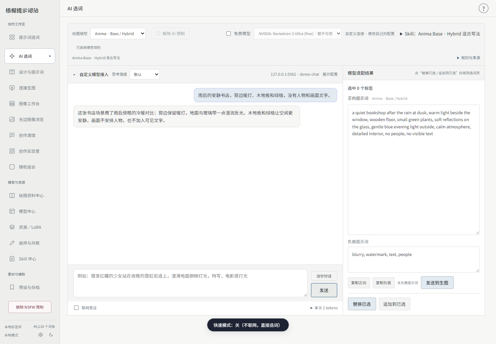
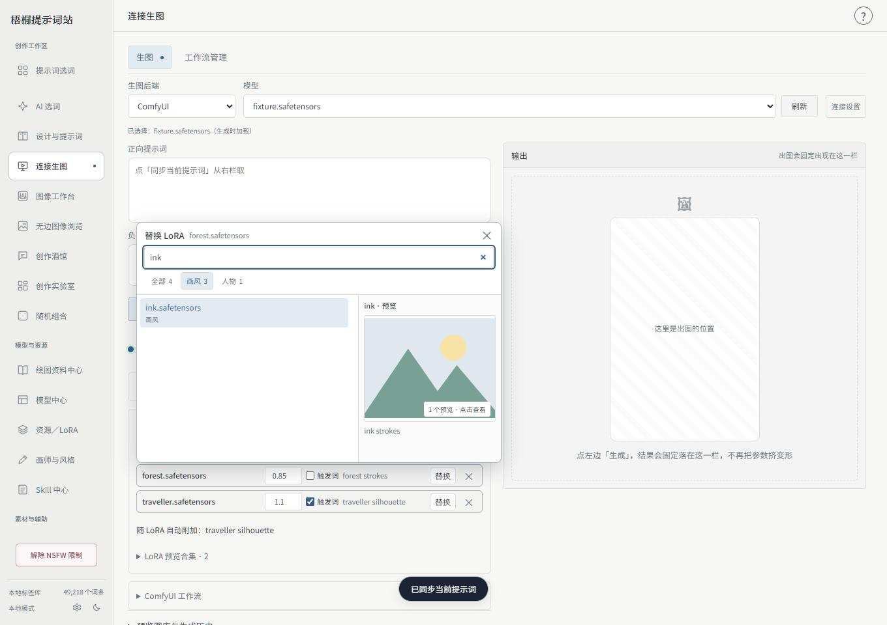
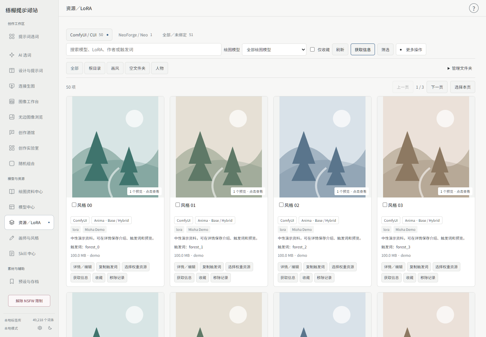
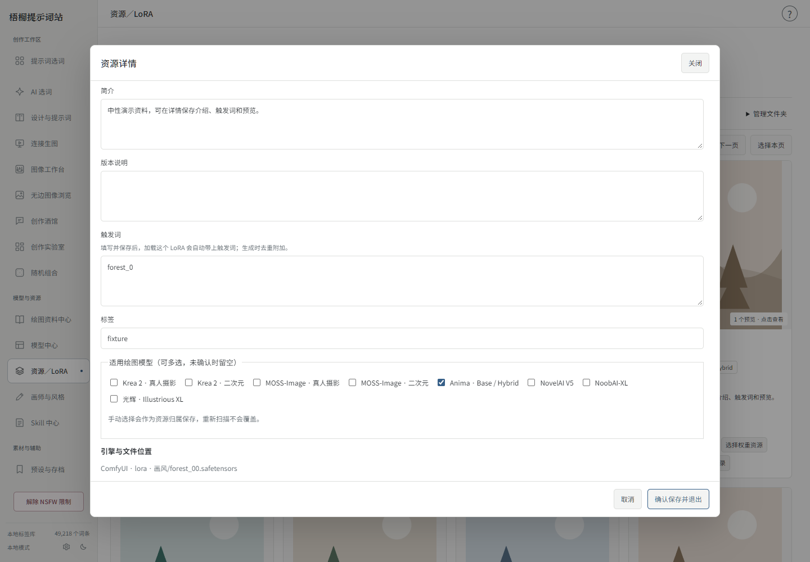

# 梧桐提示词站

**把想画的画面，整理成可以直接使用、保存和反复调整的提示词。**

找词、拼画师串、试 LoRA、切换模型，再把参数抄到生图界面——这些重复操作可以放在同一个工作台里完成。梧桐提示词站以 Windows 本地使用为主，支持手动选词与 AI 辅助，也能用独立 Android 界面连接自己的电脑。

[Windows 4.0.9 下载](https://github.com/xialing114514/mioha-prompt-station/releases/download/v4.0.9/Mioha-Prompt-Station-4.0.9-Setup.exe) · [Android 4.0.2 下载](https://github.com/xialing114514/mioha-prompt-station/releases/download/v4.0.9/Mioha-Android-4.0.2-arm64.apk) · [快速上手](docs/QUICK_START.md) · [完整使用手册](docs/README.md) · [界面截图](docs/SCREENSHOTS.md)

[4.0.7 图解教程 PDF（8 页）](docs/pdf/mioha-prompt-station-4.0.7-illustrated-guide.pdf) · [4.0.7 文字教程 PDF（12 页）](docs/pdf/mioha-prompt-station-4.0.7-user-guide.pdf)

*界面使用独立演示资料，AI 分栏为受控交互展示。[查看截图说明](docs/SCREENSHOTS.md)*

## 它能帮你做什么

| 你想做的事 | 在这里完成 |
| --- | --- |
| 有画面想法，不知道怎么写词 | 用中文描述，AI 按目标绘图模型整理；左侧讲解设计，右侧给出提示词 |
| 自己挑词、改权重、调顺序 | 正负词框直接编辑，按中英文检索，逐词调整与保存组合 |
| 保存角色外貌和常用画风 | 本地角色配方、画师与风格库；NAI 法典条目可原样保存到本地 |
| 管理模型和 LoRA，再试着出图 | 按 NeoForge／ComfyUI 区分资源，管理预览与触发词，连接引擎提交任务 |
| 比较不同搭配、整理创作结果 | 提示词卡片、批量与画风实验、分镜、图库、图像处理和酒馆 |
| 离开电脑后继续操作 | Android 独立编辑，或经授权连接自己的电脑，查看进度与结果 |

## 下载与安装

| 平台 | 当前版本 | 下载 |
| --- | --- | --- |
| Windows 10/11 · x64 | **4.0.9** | [Windows 安装包](https://github.com/xialing114514/mioha-prompt-station/releases/download/v4.0.9/Mioha-Prompt-Station-4.0.9-Setup.exe) |
| Android 7.0+ · arm64 | **4.0.2** | [Android APK](https://github.com/xialing114514/mioha-prompt-station/releases/download/v4.0.9/Mioha-Android-4.0.2-arm64.apk) |
| 模型 Skill · 可选单独下载 | **v24** | [规则包](https://github.com/xialing114514/mioha-prompt-station/releases/download/v4.0.9/mioha-model-skills-v24.zip) |

Windows 安装包包含程序运行组件，日常使用无需安装 Python 或 Node.js；电脑需要 WebView2 Runtime。规则已随软件附带，规则 ZIP 不是安装器。Android 本轮沿用 4.0.2，文件与原正式版一致。

已有版本可以退出程序后覆盖安装，个人资料和手机授权保留。安装包未使用发布者数字签名，下载来源和 SHA256 校验见 [4.0.9 发行页](https://github.com/xialing114514/mioha-prompt-station/releases/tag/v4.0.9)。

本仓库提供安装包、APK、公开模型规则和说明文档；程序源码暂未公开。

## 从第一条提示词开始

1. **选一种写法。** 在「AI 选词」选择要使用的绘图模型规范，例如 Anima、MOSS、光辉或 NAI；也可直接在「提示词选词」手动编辑。
2. **描述画面。** 例如：“雨后的安静书店，窗边暖灯、木地板和绿植，没有人物和画面文字。”可用免费通道，也可填写自己的 AI 接口。
3. **检查并调整。** 聊天区说明设计了什么，右侧是可复制、编辑、追加或替换到选词页的提示词。
4. **需要出图时再连接引擎。** 进入「连接生图」，配置运行中的 NeoForge／ComfyUI，或使用自己的 NovelAI 凭据；检查模型、LoRA 和参数后点击生成。

内置 AI 的推理由所选在线服务或自己的模型承担；安装包不附带大语言模型与绘图权重。尚未连接绘图引擎时，也可以整理提示词、角色和画风资料。

[逐步安装与上手](docs/QUICK_START.md) · [配置 AI 接口](docs/BUILT_IN_AI.md) · [连接绘图引擎](docs/MODELS_AND_GENERATION.md)

## 主要工作区

### 提示词、角色与画师串

正负提示词分开编辑，权重区同时显示词条与中文释义，长文本按内容排版。角色配方用于保存外貌设定；常用画师串、介绍、来源与封面保存在「画师与风格」。

NAI 在线法典直接接入原站，按单画师／画风组筛选，保留原站顺序，词条与预览按需读取。点击「保存到本地」会保留原始画师串、权重、介绍和来源快照；封面可继续引用原站，也可换成自己的图片。NovelAI 生图另有画师串加载区，提交时组合，编辑框内容保持独立。

[角色与配方](docs/QUICK_START.md#角色配方保存与手动备份) · [NAI 法典与本地风格](docs/NAI_CODEX.md)

### 模型、LoRA 与实际生图

模型中心与资源页按引擎管理，搜索与绘图模型筛选靠近列表。LoRA 按真实文件夹显示“全部、根目录、用户目录”，支持子目录浏览、新建、改名及移动；同名预览图、视频与元数据随权重一起移动，已有同名文件不会覆盖。Neo 底模各自记忆文本编码器和 VAE；完整底模可使用自带组件。ComfyUI 沿用自己的工作流，NovelAI 使用自己的 Token。

点「添加 LoRA」可在生图页搜索并直接加载；点已加载项的「替换」只换这一项。权重停下输入就保存。出图时可以照常用 AI 选词，本次生图沿用提交时的参数。

查看 4.0.6 文件夹管理与详情界面

使用独立中性资料演示，文件路径为示例。搜索、文件夹与分页紧邻列表；详情底部固定保存并退出和取消，点击空白可退出。

[模型、LoRA、插件与工作流](docs/MODELS_AND_GENERATION.md) · [WD14 反推安装](docs/WD14.md)

### 从单张画面到一组创作

在创作实验室把常用片段存成卡片，组合后查看最终正负提示词，再做批量或画风比较；分镜项目保存场景和候选图。图像工作台处理导入副本，创作酒馆管理角色卡、世界书与独立会话。图库集中浏览本机结果、查看参数和筛选。

[创作实验室与酒馆](docs/CREATIVE_WORKSPACE.md) · [图库与图片删除](docs/GALLERY.md) · [外部 Agent 接入](docs/AGENT.md)

## 用手机连接自己的电脑

手机有独立触摸界面，可以本地编辑，也可以读取电脑上的模型、LoRA、工作流与任务。电脑进入「连接与设置 → 远程连接」手动启用，手机扫描或粘贴连接码，再在电脑弹窗中确认设备与权限。修改配置会同步，点击生成才提交任务。

电脑承担业务服务，每次启动默认关闭远程。支持局域网与 WebRTC P2P；异地手动模式交换连接码，STUN 与可选协调入口帮助建连，不使用 TURN 中转。部分网络可能无法穿透，电脑和绘图引擎需保持运行。

[手机安装、配对、重连与设备管理](docs/MOBILE_REMOTE.md)

## 4.0.9 这次改了什么

- **找词更方便。** 标签超市单列场景、环境、物品、画面和镜头。马桶与洗手池在「场景 → 家具 → 卫浴」，背景虚化在「镜头 → 景深」。
- **常用词分得更细。** 人物可按发型、发色、瞳孔或视线查找。服饰区可分别浏览衣装和配饰，手持、手放在和抓握在表情与动作中各有筛选。54,409 个词条经整库核对，其中 659 个原先放在「其他」的词已归到更明确的栏目。
- **图片反推使用已配置的视觉模型。** 支持 OpenAI 和 Anthropic 协议。图片写有生成参数时，程序优先读取原始参数。

[4.0.9 下载与校验](https://github.com/xialing114514/mioha-prompt-station/releases/tag/v4.0.9) · [完整更新记录](CHANGELOG.md) · [标签超市用法](docs/QUICK_START.md#自己选词和改权重)

## 使用中需要查什么

| 遇到的问题 | 看这里 |
| --- | --- |
| 安装、升级、第一次写词 | [快速上手](docs/QUICK_START.md) |
| 免费模型、自定义 API、思考强度、HTTP 错误 | [内置 AI](docs/BUILT_IN_AI.md) |
| 模型目录、VAE、LoRA、高清、插件、工作流 | [模型与生图](docs/MODELS_AND_GENERATION.md) |
| 图片来源、多选、永久删除与旧删除区 | [图库](docs/GALLERY.md) |
| 更多模块、备份、手机与常见问题 | [完整手册目录](docs/README.md) |

个人资料保存在本机，覆盖升级保留数据。角色配方上传／下载备份由用户手动操作；在线 AI、资料来源与生图服务按所选功能联网。详见 [数据与隐私](docs/DATA_AND_PRIVACY.md)。

历史版本与旧界面（点击展开）

- [4.0.6：LoRA 文件夹与图库回填](https://github.com/xialing114514/mioha-prompt-station/releases/tag/v4.0.6)
- [4.0.5：接口兼容与页面完善](https://github.com/xialing114514/mioha-prompt-station/releases/tag/v4.0.5)
- [4.0.4：生图操作与图库管理](https://github.com/xialing114514/mioha-prompt-station/releases/tag/v4.0.4)
- [4.0.2：Windows／Android 与 Skill v24](https://github.com/xialing114514/mioha-prompt-station/releases/tag/v4.0.2)
- [全部历史更新](CHANGELOG.md#历史版本) · [历史界面](docs/SCREENSHOTS.md#历史界面)

当前操作以本页和使用手册为准；旧版删除、工作模式和界面说明仅作版本记录。

## 致谢与支持

感谢柒月FIGO 的设计启发，以及 **znso4-pa、四路至强超上天、百濑美月、小诺瓦** 的 AI 技术支持，也感谢开源项目作者和资料维护者。

[完整致谢](CREDITS.md) · [第三方来源与许可](THIRD_PARTY_RESOURCES.md) · [支持开发](SUPPORT.md) · [反馈与参与](CONTRIBUTING.md)

赞助完全自愿，不影响软件功能与使用权限。第三方运行组件的许可证随安装包提供。[FFmpeg 第三方源码与构建资料](https://github.com/xialing114514/mioha-prompt-station/releases/download/v4.0.9/Mioha-4.0.0-FFmpeg-ThirdParty-Sources.zip)
