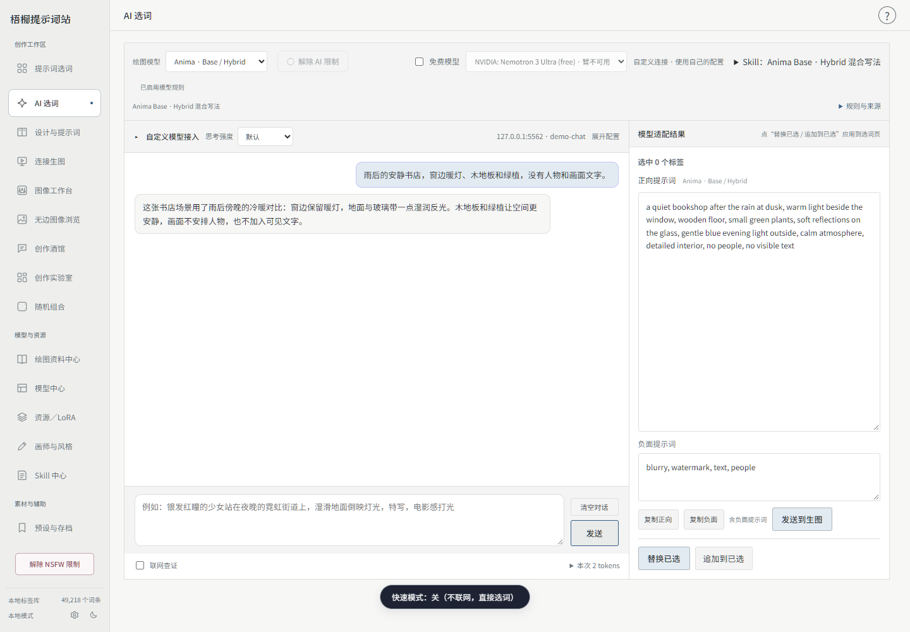

# 内置 AI 使用指南

[手册目录](README.md) · [快速上手](QUICK_START.md) · [公开模型规则](../skills/README.md)

AI 工作区把画面想法整理成目标模型的提示词：左侧讲解设计与修改，右侧保留可用结果。推理由所选在线服务或自己的模型承担，软件提供编辑界面、检索工具和模型 Skill 转换流程。

## 先分清两种模型

| 设置 | 决定什么 |
| --- | --- |
| 绘图模型规范：Anima、MOSS、Krea 2、光辉、NoobAI、NAI 或自定义 | 如何表达提示词、权重和画师串 |
| 免费／自定义大语言模型 | 谁来理解描述、查询资料与整理结果 |

实际绘图的引擎、权重、LoRA、采样参数在「连接生图」单独配置。切换写词规范不会自动替换生图权重。

MOSS 可选自然语言或布局 JSON；普通画面先用完整描述，需要精确位置与排版时再使用布局。八份内置 Skill 保持 v24，MOSS／Krea 2 的二次元与真人通道分别选择；用户自建规则保留。

## 免费模型

勾选「免费模型」后选择可用模型。默认 NVIDIA: Nemotron 3 Ultra (free)，软件保留你已保存的选择；「恢复默认模型」切回默认项，刷新读取当前清单。

刷新按钮旁的「思考强度」按模型清单声明的能力显示，按模型 ID 保存；没有声明可调能力时不可选。较高强度通常增加耗时与用量。

免费通道需要网络，限额、速度与可用性由提供方决定；它不使用发布者的 Key，也不会在失败后自动改用你的自定义接口。

## 配置自己的接口

1. 关闭免费模式，展开「自定义模型接入」。
2. 填写接口地址、API 协议、真实模型 ID 和自己的 Key。本机免鉴权服务可留空 Key，视觉模型另按需要填写。
3. 「获取模型」读取当前接口清单；没有清单时可手动填 ID。视觉能力需由该服务和模型实际支持。
4. 点击「测试连接」，检查当前表单的模型、思考设置和生成通道；成功后点「保存」。

测试会发出短推理请求，服务商可能按规则计费。它用于验证请求通道，不能保证任意长度、工具、图片或内容请求均可用。地址或 Key 改动后，需要重新获取清单并验证。

| 协议 | 地址与鉴权 |
| --- | --- |
| OpenAI Chat Completions | 一般填服务的 `/v1` 基址，也可识别完整 `/chat/completions`；使用 Bearer Key |
| Anthropic Messages | 支持服务根地址、`/v1` 或完整 `/v1/messages`；使用 `x-api-key` |
| 旧版本机服务 | 仅用于原有 `/api/chat` 服务，普通 OpenAI／Anthropic API 选择对应协议 |

已有 LiteLLM、CLIProxyAPI 等本地路由时，可填它实际提供的兼容 API 地址与模型 ID，先启动路由，再测试连接。工作台不替你安装路由或获取服务账户。

### 4.0.5 的请求兼容

测试与正式生成共用传输方式。遇到明确的 HTTP 406 格式拒绝或“不支持流式”参数错误时，软件自动协商可接受的响应格式，必要时读取 JSON 结果，并记住该连接的有效方式。

这只调整传输，不修改提示词、模型或思考强度。鉴权失败、限流、网络异常和已经开始返回的内容不会触发这种重新发送。

| 提示 | 怎么检查 |
| --- | --- |
| HTTP 401 / 403，或网关正文提示鉴权失败 | 核对协议、Key、账户和模型权限 |
| HTTP 406 自动协商后仍失败 | 检查服务商返回的错误及网关规则，不能只凭状态码认定是请求头 |
| 不支持的参数或模型 | 使用真实模型 ID，核对接口能力；不支持思考参数时自行改回默认档 |
| 模型成功返回拒答 | 表明请求已到达；服务内容规则与软件接口连通性分别判断 |

### OpenCode Go

程序使用自身的 `MiohaPromptStation/版本号` 客户端名称与会话标识。服务用途、模型权限和额度以提供方规定为准；模型是否允许通用聊天或绘图用途需自行核对[官方说明](https://opencode.ai/docs/console/go/#where-can-i-use-it)。

## 思考强度

自定义连接的思考强度在配置收起后仍可调整，按接口、协议和模型 ID 保存，与免费模型独立。默认档沿用服务设置，其他档位按对应协议发送。

4.0.5 的连接测试会携带当前选择；正式对话、工具续轮与提示词整理也使用该设置。较高档位会预留更多输出空间，通常增加耗时和用量，是否支持以接口实际能力为准。

## 描述、查询与联网

可以直接描述画面，也可以指名查询本地标签、角色配方、绘图资料和资源。新建或编辑后的角色配方可由同一个本地检索入口读取；其他来源的空结果不等于配方不存在。

「联网查证」控制额外的资料查询。关闭后优先使用本地资料；选用在线 LLM 时，推理仍然联网。视觉识别需要已保存的视觉配置与支持图片的服务，推测结果与官方设定要区分。

## 聊天与右侧结果

左侧保留模型对角色、构图、画风和光影的讲解；右侧显示可复制、修改、替换／追加到选词页，或发送到生图的提示词。纯文本结果在可识别时也可进入右侧，正负标记、权重和 LoRA 文本保留。

无法明确判断的文本继续显示在聊天区，可以要求模型按“正向提示词：”“负面提示词：”标记。普通讨论和拒答不会写入绘图框；模型未给出讲解时，程序不会编造设计内容。

## 停止、清空与数据

「停止回复」停止本机接收与后续工具执行；已经返回的内容可留在当前聊天。「清空对话」删除当前消息、草稿、结果和缓存，立即开始新会话，迟到回复不能回填。

AI 工作区不保存历史列表，当前上下文只在运行内存中；刷新或重启从空对话开始。模型连接、Skill、思考设置与本地用量记录保留；角色配方、酒馆与绘图结果各自独立。

内置 Agent 没有面向用户的预设选择入口。内容模式先受全局 NSFW 确认约束，再应用当前 AI 偏好；这不会改变外部服务规则。用量统计依据服务返回数据，不等于账单承诺。[数据与隐私](DATA_AND_PRIVACY.md)
