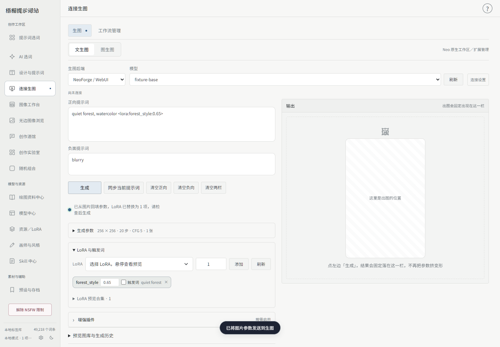
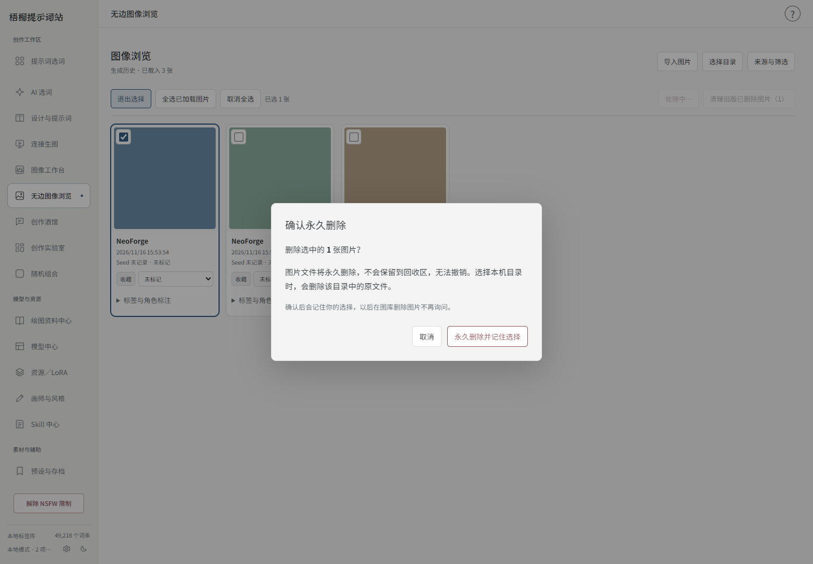

# 图库、选择与永久删除

[手册目录](README.md) · [模型与生图](MODELS_AND_GENERATION.md) · [数据与备份](DATA_AND_PRIVACY.md)

本页对应 **Windows 4.0.7** 的「无边图像浏览」。这一版的删除直接移除文件，首次确认后记住选择。

## 找到要看的图片

打开图库，默认先展示图片。点击「来源与筛选」展开目录与查询条件，选择生成历史、图像工作台、参考素材或已配置的引擎输出目录；也可「选择目录」浏览自己的本地文件夹。

「导入图片」支持一次选择多张。按引擎、提示词和高级条件筛选；点击普通图片打开预览，可以缩放、拖动、查看参数或发送到生图。

## 发送到生图与 LoRA 回填

打开图片大图预览，等待生成参数读取后点击“发送到生图”，再检查配置并生成。支持软件生成历史和可读取参数的本地图片。

- 图片里的 LoRA 替换当前生图列表；没有 LoRA 的图片会清空原有选项。
- 保留记录中的模型权重、CLIP 权重、资源身份和触发词开关；本地资源移动后按身份同步位置。
- WebUI 元数据分别读取双权重；ComfyUI 沿有效输出／采样连接链取 LoRA，断开的加载节点不加入列表。
- 只有 LoRA 名称、没有记录权重时，会暂用 1 并提示检查；图片没有保存的参数无法凭空恢复。

## 多选与键盘操作

| 操作 | 结果 |
| --- | --- |
| 勾选图片左上角，或点击「选择图片」 | 进入选择模式 |
| 选择模式中点击图片 | 切换该图片的选择状态 |
| Shift 连选 | 按当前排列连续选择 |
| 「全选已加载图片」或选择模式中的 Ctrl+A | 选择已加载内容，未加载图片不包含在内 |
| Esc | 退出选择模式 |
| 「删除所选」或选择模式中的 Delete | 删除选中图片，首次先显示确认 |

## 首次确认之后会发生什么

第一次删除会显示“图片文件将永久删除，不会保留到回收区，无法撤销”。取消会保留文件；选择「永久删除并记住选择」后才执行，并将选择保存在本机，重新打开页面或重启程序后仍有效。

**此后点击删除会直接执行，不再逐次弹窗。** 删除前请确认图片来源和已选数量；当前版本没有“撤销删除”入口。

## 删除的是哪一份

| 来源 | 删除范围 |
| --- | --- |
| 生成历史 | 选中的结果文件及相关缩略图；同一组其他图片保留 |
| 图像工作台 | 工作台导入／生成的副本及对应记录 |
| 已选择本机目录、引擎输出目录 | **该目录中所选的原图片文件** |
| 参考素材列表 | 移除参考条目；原图和已提交任务的快照保留，按该列表自己的删除提示操作 |

图片被占用、正在由任务使用或文件无法移除时，软件会报告未完成项及已完成数量；先处理失败原因，再核对剩余图片。

## 清理旧版已删除图片

4.0.4 的删除区可能仍占用磁盘空间。当前版本**不会在升级时自动清理**；有旧文件时，图库显示「清理旧版已删除图片」，需要释放空间时再点击。

清理针对软件旧版专用删除区，不会按旧清单去删除其他目录里的原图。清理后无法恢复。当前新删除的文件不会再进入这个区。
