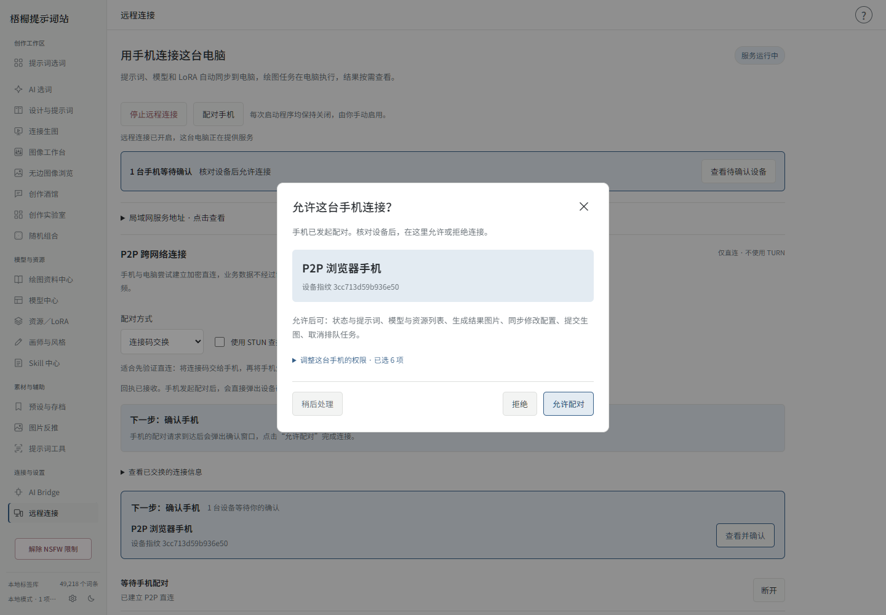

# 手机连接、配对与重新连接

[项目主页](../README.md) · [快速上手](QUICK_START.md)

适用于 Windows 与 Android **4.0.0**。手机是独立界面，电脑负责实际资源和任务；不是远程桌面。

## 第一次连接

电脑启动梧桐提示词站和绘图引擎，在「远程连接」手动启用。首次需要阅读说明并勾选确认；仅打开页面不会开启监听，重启后也不自动开启。

手机进入管理 → 连接我的电脑，扫描或粘贴连接码。同一局域网可以用 HTTPS 配对码，异地可尝试 P2P 连接码。不要只粘贴一个电脑地址，配对需要完整身份信息。

手动 P2P 需要把手机生成的回执粘贴到电脑。接收回执只是建立数据通道；手机提交设备请求后，电脑直接弹出「允许这台手机连接？」。核对名称、指纹和权限再允许。稍后处理会保留入口，不会自动同意。

## 再次连接

| 当前情况 | 如何处理 |
| --- | --- |
| 手机与电脑在同一局域网，电脑远程已启用 | 点击手机「重新连接」，使用固定电脑身份与已授权设备重新握手，无需再次审批 |
| 使用旧版手动 P2P，尚未保存新重连地址 | 点击后按提示扫描电脑的新连接码，原设备身份保留 |
| 异地且已经配置可用协调入口 | 用已配对设备身份重新建立 P2P 通道 |
| 异地，没有协调入口 | 更换新连接码并交换回执，不能重复使用已处理的一次性回执 |
| 电脑关闭、休眠或未启用远程 | 先在电脑恢复运行并手动启用 |
| 设备已撤销或电脑身份改变 | 重新配对；不能靠旧令牌恢复权限 |

4.0 修复了「重新连接」没有反馈的问题。新手动连接码会优先复用该电脑已保存的设备授权，正常情况下不需要先解除连接再添加。局域网的电脑 IP 或端口改变后，可能需要一次新连接码更新地址。

手机新版本需要与电脑 4.0.0 配合。第一次从旧测试版升级，先换一次电脑生成的新码，保存新版重连信息。覆盖安装保留手机安全区身份；清除应用数据或卸载后需重新配对。

## 同步与绘图

手机读取电脑当前后端、底模、组件、LoRA、工作流与参数。选词、选择模型和改参数会同步，不会自动开始绘图。输入有短暂防抖，等待同步成功后再生成。

生图使用电脑实际配置与任务 ID。断线不会重复执行任务；恢复后查询原任务和结果。已发送的任务快照与下一份草稿分开。两端同时改同一内容时，按冲突提示选择保留版本。

手机不会远程安装电脑模型、执行系统命令或绕过 Owner 权限。部分高级字段仍在电脑配置，手机按实际开放能力操作。

## 设备管理

电脑可撤销手机权限，立即阻止其后续访问。已撤销记录可以点击「删除记录」，确认后从列表移除；个人角色、模型文件、绘图历史和结果不受影响。删除后该设备需重新配对。

## P2P 与网络

无需云端业务服务器，模型、资料与绘图任务都由自己的电脑处理。STUN 辅助发现地址，可选协调入口只交换短期连接证明和网络信息；当前不内置公共协调服务，不配置 TURN，也不会自动中转业务数据。

P2P 并不保证所有网络都能穿透。限制 UDP、严格 NAT 或不同运营商环境下，可能需要更换网络或使用可直达电脑的网络。手动码过期时生成新码，不要反复粘贴旧回执。

局域网重连、设备保存与真实 WebRTC 已通过 Android 35 模拟器的实际 App WebView 验证；隔离测试没有消耗实际生图额度。跨运营商真机环境仍取决于用户网络，不能将模拟器结果视为所有手机的连通保证。
