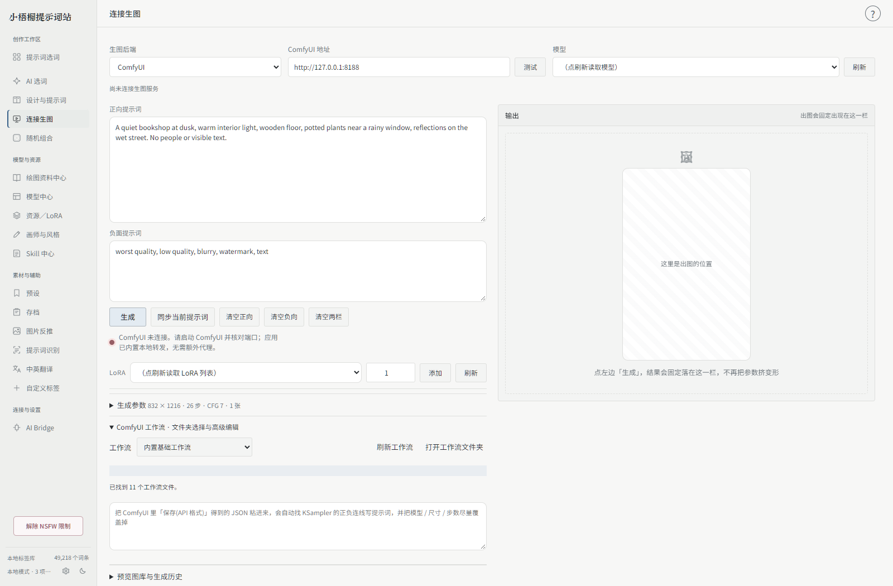

# 模型、LoRA 与生图

[手册目录](README.md) · [Skill 规则](../skills/README.md)

## 模型分类与引擎分开理解

| 对象 | 示例 | 负责什么 |
| --- | --- | --- |
| 绘图模型规范 | Anima、MOSS、光辉 Illustrious、NAI、自定义 | 提示词格式、权重和画师语法、Skill |
| 生图引擎 | NeoForge、ComfyUI、NovelAI API | 实际加载权重并执行绘图 |
| 本地权重资源 | Checkpoint、Diffusion／UNET、LoRA | 模型文件、预览、触发词与兼容性 |

选择某个模型规范不代表对应权重已安装；读取到资源也不代表任意引擎都能执行它。

## 读取本地模型与 LoRA

首次进入资源页按路径向导操作：可自动查找常见位置、选择原生文件夹或直接输入。LoRA 文件夹可独立读取，不要求伪装成整个引擎根目录；NeoForge 与 ComfyUI 分别配置。保存中暂时锁定输入，避免后一次编辑被前一次响应覆盖。ComfyUI 会结合自身模型目录及支持的额外路径配置读取资源。

卡片区分所在引擎与适用模型。共享目录中的同一权重可以同时出现在两个引擎下。归属不明确时保持待确认，可在详情中人工指定；不要仅凭文件名或「SDXL」字样就认定具体模型系列。

## 获取预览、介绍与触发词

选中资源或在当前范围使用「获取信息」。程序利用可用的本地元信息、版本信息或文件哈希查询 Civitai，读取介绍、版本、预览和 trainedWords。也支持通过 Civitai／civitai.red 链接导入资料。

未提供的信息保持未知。资料导入不等于已下载模型权重；访问受限时检查自己的凭据、网络或代理。安全模式隐藏 NSFW 与未确认安全的预览，不能据此判断权重损坏。

## 自定义分类与版本更新

勾选资源后打开「分类管理」，创建或重命名自己的分类，再将资源归入勾选分类。分类独立于引擎、模型兼容性和上游标签；删除分类仅移除分类关系，保留资源与权重。

「更新」检查当前范围或选中资源的来源版本，卡片提示可用的新版本。它不会自动下载或覆盖当前权重；联网信息与手工记录分别保留。

## LoRA 与触发词联动

在连接生图中加载实际 LoRA 后，可联动资源库中的触发词，检查逐项开关与最终正向内容。零权重不应作为有效加载；移除 LoRA 不应误删手写提示词。

若效果与作者预览不同，依次检查底模版本、LoRA 注册名、触发词、权重、采样参数与工作流组件。多 LoRA 会互相影响，适合先逐个验证，再比较组合效果。

## 连接引擎与工作流

- **NeoForge**：启动自己的引擎并启用 API，填入本机地址，测试连接、刷新模型与 LoRA。软件显示本次任务的进度、实时预览和耗时。
- **ComfyUI**：启动服务，填入地址，读取可用节点与模型。复杂架构请导入与当前模型匹配的 **API 格式 JSON** 工作流；普通 UI 工作流文件不一定能直接提交给 API。
- **MOSS**：准备匹配的模型组件与工作流，不把通用 SD 工作流直接当成 MOSS 工作流。
- **NovelAI**：配置自己的凭据，确认所选模型、参数、额度与服务限制后生成。费用由服务提供方规则决定。

NeoForge 与 ComfyUI 分别保存采样参数。执行前检查当前提示词、底模、LoRA、尺寸、步数、CFG 和工作流；不要仅看卡片名称。

## 从文件夹选择工作流

点击连接生图页的「打开工作流文件夹」，把工作流 JSON 放进去，刷新后直接选择，无需每次粘贴整段 JSON。以软件打开的目录为准；通常是安装目录的 `workflows/ComfyUI`，不可写时使用个人数据目录。

```text
workflows/
└── ComfyUI/
    ├── 人物插画.json
    └── 场景工作流.json
```

API 格式可直接载入。常规 UI 格式会读取已连接 ComfyUI 的节点定义，再转换为 API 图；缺少节点、旁路、PrimitiveNode、复杂组件插槽或无法确定的语义会明确提示导出 API 格式，不猜测转换。载入不会立即生成图片。



## 进度与耗时

生成按钮下方以紧凑一行显示当前任务阶段、采样进度和耗时，结束后自动收起，保留本次总耗时。NeoForge 使用本次任务的内部进度；ComfyUI 通过独立 clientId 和本机事件流接收新版节点与采样事件，显示的是当前采样节点的步数，不把多阶段工作流冒充为单一总进度。NovelAI 等接口未返回逐步百分比时显示静止的等待状态与耗时，不伪造数字或显示来回摆动的进度。

## 图片复制与图库

右侧结果下方可切换图片、复制、保存与放大预览；点击图片在软件内打开图库，支持键盘左右切图、缩略图选择和原尺寸查看。Windows 桌面版使用图片剪贴板，可以直接粘贴到支持图片的应用。

左侧展开「预览图库与生成历史」可按引擎、提示词查找本机历史，浏览器先载入缩略图，点击后才打开大图。每页24组，可继续载入。图库折叠或离开生图页后停止后台刷新。安全模式仍限制未确认分级的历史图片，不会删除原始文件。

## 历史与异常

结果可在程序内预览并查看历史。上游返回图片但本地保存失败时，会保留可恢复的信息和明确错误，不把它当作需要重新执行的请求。

原图来源、生成参数与模型实际加载记录比「看起来像没生效」更适合排查问题。反馈时同时提供引擎、底模、LoRA、工作流类型和脱敏请求信息。
